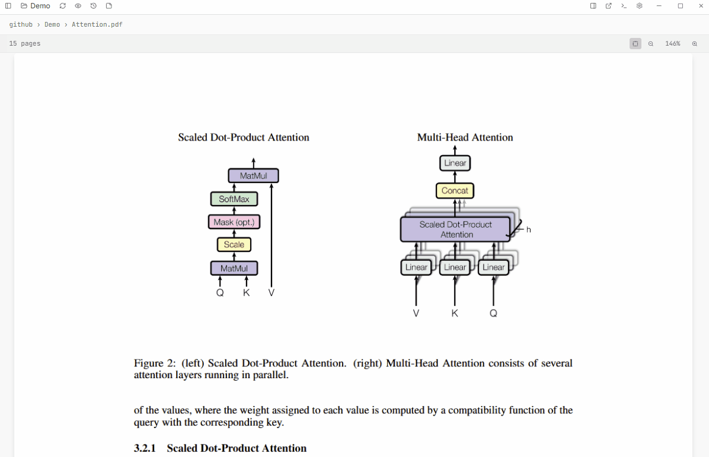
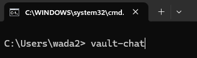

# vault-chat

vault-chat is a desktop app for a folder of notes and PDFs (your "vault") with an AI agent built in: it sees what you
are reading, writes and edits your files, and can change the app itself when you ask it to.



## Install on Windows

1. Download the installer from the [latest release](https://github.com/carlwilsn/vault-chat/releases/latest): `vault-chat_X.X.X_x64-setup.exe`.
2. Run it. The installer is not code-signed yet, so Windows shows **Windows protected your PC**: click **More info**,
   then **Run anyway** (once). After that the app checks for updates by itself and offers **Install & restart**.
3. In the app, click **Open folder** in the title bar and pick a new, empty folder: that is your vault. On the app's
   first run a new, empty vault gets a five-minute tutorial (a card in the corner, a sample paper in `Welcome/`).
4. Sign in with your Claude account: Settings shows the line to sign in. On Windows you run `claude setup-token` in a
   terminal (it needs [Claude Code](https://docs.anthropic.com/en/docs/claude-code)) and paste the token it prints.

## Install on a Mac

Apple Silicon Macs only (no Intel build is published). There is no notarized download: the simplest way in is to let
your own Claude Code install it, because a download made with `curl` is not quarantined and opens without the
"damaged / unidentified developer" dialog. Open Claude Code in a terminal and say:

> Install vault-chat for me: follow the "If you are an AI agent installing this for someone" section of
> https://github.com/carlwilsn/vault-chat

It downloads the app into `/Applications`, makes your vault at `~/vault-chat`, opens the app, and asks you for one
click: **Authorize** in your browser, to sign the app in with your Claude account. The first time the app opens, the
tutorial starts in the corner.

## If you are an AI agent installing this for someone

Mac (Apple Silicon) only. Run each step, check its result, and tell the user plainly what you did and anything they
must do. Never put the vault in `~/Documents`, `~/Desktop` or `~/Downloads` (macOS asks for permission there; the app
refuses them and uses `~/vault-chat` instead).

1. **Check the machine.** `uname -m` must print `arm64`. `claude --version` must work: the app's sign-in runs
   `claude setup-token` (you are probably that `claude`).
2. **Download the newest Mac build.** A Mac build is published only from a check where every Mac test passed, and
   its release then carries `mac-update.json`. Take the newest release that has one, and the app bundle it names:
   ```sh
   MANIFEST=$(curl -fsSL "https://api.github.com/repos/carlwilsn/vault-chat/releases?per_page=50" \
     | grep -o 'https://github.com/carlwilsn/vault-chat/releases/download/[^"]*/mac-update.json' | head -1)
   URL=$(curl -fsSL "$MANIFEST" | grep -o 'https://[^"]*\.app\.tar\.gz' | head -1)
   echo "$URL"   # vault-chat_<version>_aarch64.app.tar.gz
   ```
   (The same release also has a `.dmg`; use the `.app.tar.gz`: it needs no mounting.)
3. **Install it to /Applications with curl** (curl does not quarantine, so there is no Gatekeeper dialog):
   ```sh
   curl -fsSL "$URL" -o /tmp/vault-chat.app.tar.gz
   rm -rf /Applications/vault-chat.app
   tar -xzf /tmp/vault-chat.app.tar.gz -C /Applications
   ```
4. **Pick the vault before the first launch.** Write the setup file; the app's first window opens that folder (making
   it if missing) and reads the file once (it is renamed `setup.used.json`). Leave `~/vault-chat` empty or let the app
   make it: a new, empty vault on the app's first run gets the tutorial.
   ```sh
   mkdir -p ~/Library/Application\ Support/vault-chat
   printf '{"vault": "~/vault-chat"}\n' > ~/Library/Application\ Support/vault-chat/setup.json
   ```
   (Or launch once with the environment variable `VC_SETUP_VAULT=~/vault-chat`.)
5. **Launch it:** `open /Applications/vault-chat.app`.
6. **Sign in (the user's one click).** Ask the user to click **Sign in with Claude** in the app (at the top of
   Settings, or where the chat asks for it). The app runs `claude setup-token` itself and opens their browser; they
   click **Authorize** once. Nothing is pasted, and the token goes straight into the macOS keychain: never ask for
   it, never print it. If it cannot finish, the app shows the reason and a paste field instead.
7. **Read the status** (it never contains a token or key):
   ```sh
   /Applications/vault-chat.app/Contents/MacOS/vault-chat --status
   ```
   It prints the app's status file (`~/Library/Application Support/vault-chat/status.json`) with `running` added,
   and exits without starting a second app. Done means `"running": true`, `"signedIn": true`,
   `"vaultOpen": true` with `"vault"` = their `~/vault-chat`, and `"server": {"healthy": true}`. The app rewrites the
   file every 10 s until it is signed in with a healthy server, so read it again after the user's click.
   If `"needsCommandLineTools": true`, git needs macOS's Command Line Tools: tell the user to run
   `xcode-select --install` and click Install (`gitHelp` says the same). `"signInError"` says why a sign-in failed.
8. **Report** to the user: the version installed, where the vault is, whether they are signed in, and that a short
   tutorial is waiting in the corner of the window ("delete the tutorial" removes it when they are done).

## What's in it

- **Ctrl+K inline edit** on any paragraph or code selection. `Ctrl+L` for an ask mode that answers in the same popover without touching the file.
- **PDF marquee** — drag a rectangle over any region of a PDF. Selected text + the pixel screenshot go to the model together. Works on math, tables, scanned pages, handwriting.
- **A real local-file agent**. The chat agent has the full Claude-Code-style toolset — `Read` / `Write` / `Edit` / `Delete` / `Glob` / `Grep` / `Bash` / `ListDir` / `NotebookEdit`, plus `PdfExtract` / `PdfPageSnapshot` for documents, `WebSearch` / `WebFetch` for the web, and `GitLog` for history. It edits files, runs commands, and works across your whole vault.
- **Voice mode** (`Ctrl+D`) — a hands-free conversation with the agent that still drives the file tools. Interrupt mid-sentence and the agent stops talking, acknowledges, and reroutes — useful when you're studying and need to derail the explanation a few times before it clicks. Powered by ElevenLabs; needs a separate key (free tier is 15 min/month).
- **Model-agnostic, per role**. Anthropic, OpenAI, Google, or OpenRouter (one key, hundreds of models). Swap mid-session via the settings dropdown, or pick **Auto** for smart routing that saves credits. You can also set a different model per role — chat, the phone assistant, mission supervisors, background workers, and voice — so cheap models do the grunt work and a strong model handles the chat.
- **Git-backed**. Every agent turn that touches files auto-commits, and edits are autosaved to git locally. Vault never loses state; the history is plain git.
- **Per-vault memory**. The agent keeps a file-based memory scoped to each vault at `.vault-chat/memory/` — one fact per markdown file with an index it loads each session. Tell it "remember that I prefer X" and it persists; it travels with the vault in git. No special tools — it uses Read / Write / Edit, the way Claude Code keeps memory for itself.
- **Notes scratchpad** (`Ctrl+N`). Capture a thought anchored to whatever you're looking at — file + line, PDF page + region, conversation turn. Stored as JSONL at `<vault>/.vault-chat/notes.jsonl`. The agent can list, create, resolve, and reopen them via `ListNotes` / `CreateNote` / `ResolveNote` / `ReopenNote` tools — ask "what did I flag?" or "remember this for later" and it does the right thing.
- **File hiding**. Right-click any file or folder → Hide. Hidden entries drop out of the file tree but stay on disk; the list lives in `.vaultchatignore` at the vault root (gitignore-style syntax). This is purely a tree-view declutter for build artifacts and noise — *the agent still sees hidden files via Glob/Grep/Read.* Not a security boundary.
- **Chat popout**. The external-link icon in the titlebar pops the chat into its own window so you can keep reading on the main one while a long agent run streams in the background. State stays in sync — same conversation, same tool calls, same scrollback. Close the popout to dock the chat back.
- **`Ctrl+T`** starts a fresh chat. **`Ctrl+J`** opens your system terminal in the active vault (Windows Terminal / Terminal.app / your default Linux emulator). **`Alt+L`** flips the whole UI between light and dark.

## Background work: missions, schedules & the cockpit

The agent isn't only a chat box you watch. It can take on a goal, fan out into background work, and report back — on your desktop or your phone.

- **Missions.** Ask for something big ("rewrite my lecture notes into a study guide, then quiz me on the weak spots") and the agent proposes a **mission** — a goal plus an explicit list of *done-when* criteria — as a plan card. You approve it (one tap), and a supervisor runs it: it spins up **workers** for the pieces, steers them, checks off each criterion as it lands, and retires the mission when everything's done. You watch progress accrue instead of babysitting a single long turn. Workers can run on a cheaper model than the supervisor (see per-role models above).
- **Schedules.** Tell the agent "every weekday at 7am, brief me on what's due" or "remind me in an hour" and it sets up a schedule. Recurring or one-off, it fires whether or not the vault is in focus, and the result is summarized and delivered (push notification / alert feed). A morning **coach** check-in is just a daily schedule pointed at a coaching prompt. `Ctrl+Shift+S` opens the schedules panel.
- **The cockpit.** A home-screen PWA that serves the *whole* agent to your phone over your [Tailscale](https://tailscale.com/) mesh (Settings → Phone gives you the link). Four surfaces: **Chat** (streaming replies, real markdown), **Voice**, **Activity** (live missions and workers with a thought→action timeline and a deterministic kill button), and **Alerts** (a two-class feed — informational pings and "needs you" decision cards you can answer in your own words). Vault files open in a tap; Web Push delivers coach check-ins, alerts, and run-done notifications even when the app is closed. Design notes in [docs/phone.md](docs/phone.md).
- **Always-on mode.** Background-mode (Settings) keeps vault-chat running in the system tray and starting at login, so schedules and missions keep firing while the window is closed — turn it on for the one machine you want to be "always there." Vaults sync across your machines over git (auto-commit + pull), and a single-firer guard makes sure only one machine runs the scheduled work even when several have the vault open.

> These features lean on an always-on machine and a Tailscale tailnet — they're built for "set it running and check from your phone," not required for day-to-day desktop use. If you just want the editor + chat + PDF tools, ignore this section entirely.

## Per-vault config — the `.vault-chat/` folder

vault-chat treats **every folder as a vault**, and everything the agent needs travels *inside* the vault, in a `.vault-chat/` directory at its root. There's no separate global/meta vault — open a new folder and it's seeded from the app's bundled defaults on first use, then it's yours to edit. Because it lives in the vault, it syncs across your machines via git like any other file.

| Path | What's there |
|---|---|
| `.vault-chat/agent/system.md` | the agent's system prompt for this vault |
| `.vault-chat/agent/voice.md`, `assistant.md`, `supervisor.md` | role prompts (voice mode, phone assistant, mission supervisor) |
| `.vault-chat/agent/north-star.md` | a short brief declaring what this vault is *for* — prepended to every turn so the agent enters pre-briefed (tutor vs. co-engineer vs. from-scratch). Edit it from the titlebar modal or just ask the agent to update it. |
| `.vault-chat/skills/` | your custom skills (`/slash-command`s) |
| `.vault-chat/tools/` | your custom tools |
| `.vault-chat/memory/` | the agent's per-vault memory |
| `.vault-chat/notes.jsonl`, `schedules.jsonl` | your `Ctrl+N` notes and your schedules |

The vault is git-versioned with auto-commit, so all of the above is undoable and syncable. Stale default prompts auto-upgrade to the current bundle on open *unless you've edited them* — so an improved default reaches your existing vaults without ever clobbering your customizations.

### Creating new skills

Ask the agent: *"Make me a skill for reviewing math HW."* It writes `.vault-chat/skills/review-hw/SKILL.md` with YAML front-matter. Next turn the skill is invokable as `/review-hw` in chat.

### Creating new tools

Ask: *"Build me a tool that fetches the Champions League standings."* The agent writes `.vault-chat/tools/champions-league/TOOL.md` (JSON Schema input spec) + `run.py` (reads stdin JSON, prints stdout JSON). Available on the next turn, in that vault.

## Security

API keys live in the OS keychain (Windows Credential Manager / Mac Keychain / Linux libsecret), not in localStorage or plaintext files. The agent's file-operation tools (`Read`, `Write`, `Bash`, etc.) cannot reach them.

The agent cannot modify files inside any `.git/` directory — the file-op tools refuse those paths so the undo system stays intact.

### Sandboxing the agent

By default the agent is restricted to the active vault. Two toggles in **Settings → Security** control this:

- **Strict vault mode** (on by default): `Read`, `Write`, `Edit`, `Delete`, `Glob`, `Grep`, `ListDir`, `NotebookEdit`, and `PdfExtract` refuse any path outside the active vault. Paths containing `..` are rejected. Turning this off lets the agent reach anywhere your OS user can.
- **Disable Bash** (on by default; auto-enabled with strict mode): removes the `Bash` tool from the agent's toolset entirely. Bash is *not* covered by strict mode — true shell containment needs OS-level sandboxing (job objects on Windows, seccomp/landlock on Linux, sandbox-exec on macOS) which vault-chat doesn't have. So if you want strict mode to mean anything, you also want Bash off, or the agent can shell out around the guard.

Known limitations of strict mode: symlinks inside the vault that point outside aren't resolved, so a symlink could be followed through. The guard is a string-prefix check, not a kernel-level sandbox — it's a guard rail for an LLM that occasionally goes off-script, not a defense against a determined attacker. If you turn Bash on with strict mode, the agent can run any command your shell can.

### What the agent can see inside the vault

Even in strict mode, the agent has full read/write across the active vault. Two things to be aware of:

- **Hidden files are not hidden from the agent.** `.vaultchatignore` only filters the file tree UI. `Read`, `Glob`, and `Grep` still hit hidden files. If something is sensitive, don't put it in the vault — keep it outside, or add a `.gitignore` and store it elsewhere.
- **Your notes are accessible.** Anything you save with `Ctrl+N` lands in `<vault>/.vault-chat/notes.jsonl` and the agent can list it (`ListNotes`), close it (`ResolveNote`), or write new entries (`CreateNote`). This is by design — "what did I flag yesterday?" is a useful question — but worth knowing if you scribble anything you wouldn't want surfaced in a chat reply.

## Got an idea for the app?

Reach out to me (Carl) at [carlwilson2027@u.northwestern.edu](mailto:carlwilson2027@u.northwestern.edu). I'll help you cleanly clone the repo so you can make your own version — either with Claude Code driving the changes or by hand if you'd rather code it yourself.

## Build from source

If you want to hack on it, run unreleased changes, or you're on Linux: clone the repo, install the prereqs once, and launch it from your terminal.

### 1. Install prerequisites (one-time)

#### macOS

```sh
# Homebrew (skip if you already have it)
/bin/bash -c "$(curl -fsSL https://raw.githubusercontent.com/Homebrew/install/HEAD/install.sh)"

xcode-select --install            # git + cc (skip if already installed)
brew install node rustup-init
rustup-init -y
```

~5 min total. npm ships with Node — no separate install.

#### Linux (Debian / Ubuntu)

```sh
# Build tools + Tauri deps
sudo apt update
sudo apt install -y build-essential curl git libssl-dev libgtk-3-dev \
  libayatana-appindicator3-dev librsvg2-dev libwebkit2gtk-4.1-dev

# Node 20 via NodeSource
curl -fsSL https://deb.nodesource.com/setup_20.x | sudo -E bash -
sudo apt install -y nodejs

# Rust
curl --proto '=https' --tlsv1.2 -sSf https://sh.rustup.rs | sh
```

~5 min total. npm ships with Node — no separate install.

#### Windows

**Terminal path** (Windows 11 or any recent Win 10 with winget):

```powershell
winget install OpenJS.NodeJS.LTS
winget install Rustlang.Rustup
# Then run rustup from a fresh shell and accept defaults (installs MSVC build tools, ~1.5 GB)
rustup-init
```

**GUI path** (older Windows without winget):

1. Install [Node 20+](https://nodejs.org/).
2. Install [Rust via rustup](https://rustup.rs/). Accept defaults — installs MSVC build tools.

WebView2 ships with Windows 10/11 — nothing to install either way.

~20 min total, mostly the MSVC download. npm ships with Node — no separate install.

### 2. Clone + install + register the command

```sh
git clone https://github.com/carlwilsn/vault-chat
cd vault-chat
npm install
npm link
```

~1 min. `npm link` puts `vault-chat` on your `PATH` via npm's global bin folder, so the command works from any terminal. Unlink later with `npm unlink -g vault-chat`.

> **Don't move the cloned folder after this step.** `npm link` points the global `vault-chat` command back at `bin/vault-chat.js` inside this folder — move it and the command breaks. If you need to relocate it, `npm unlink -g vault-chat`, move the folder, `cd` in, and re-run `npm link`.

### 3. Launch

Just type `vault-chat` anywhere from your terminal and the app will open.



The launcher just runs `npm run tauri dev` in the foreground under a shorter name — you'll see cargo's output live. **First run takes ~10–15 min** while Rust compiles everything; subsequent runs are ~2 seconds because cargo caches incrementally.

## License

MIT. See [LICENSE](./LICENSE).
